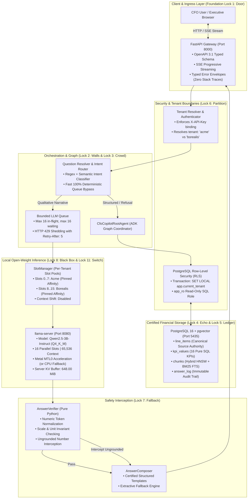
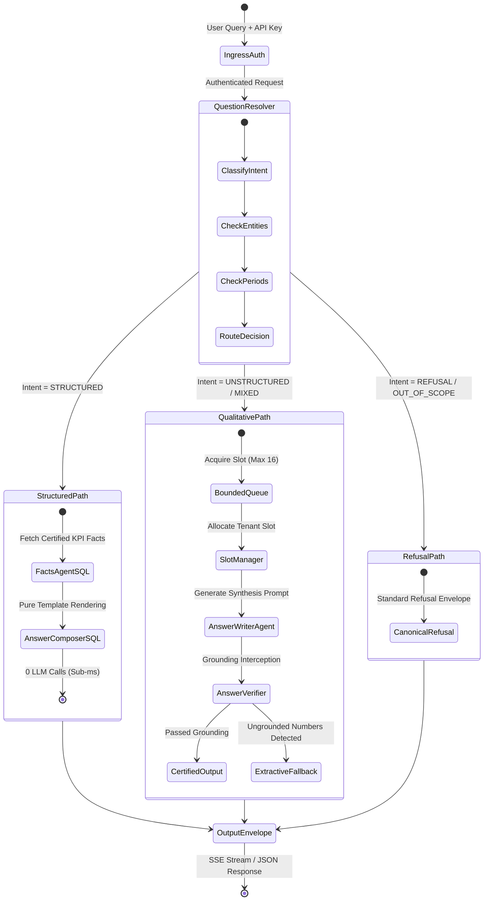
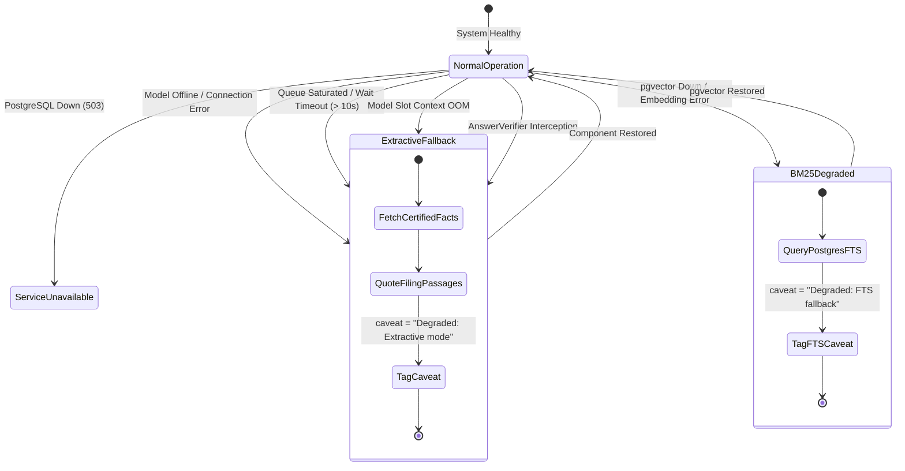

# BLUEPRINT.md: CFO Copilot Production Architecture Blueprint

> **System**: CFO Copilot on a Budget  
> **Phase**: Production Deliverable (Single Source of Truth)  
> **Target Hardware Budget**: Single 6.0 GB VRAM Budget | 16 Parallel Slots | TTFT < 2,000 ms  
> **Authoritative Commit**: `freeze-before-v3` (`3d44926`)  
> **Date**: 2026-11-16  

---

## 1. Executive Summary & Core Architectural Principle

CFO Copilot is a private, multi-tenant financial intelligence system built for executive CFO decision support across six public enterprises: **Aurora Retail Group (ARG)**, **Cobalt Energy Partners (CEP)**, **Helix BioSystems (HBS)**, **Meridian Software Inc (MSI)**, **Northwind Industrial (NWI)**, and **Zephyr Logistics (ZLG)**.

The system is engineered around one non-negotiable financial invariant:
$$\mathbf{A\ wrong\ number\ is\ strictly\ worse\ than\ no\ answer.}$$

To uphold this invariant:
1. **100% Deterministic SQL for Financial Data**: All 16 key performance indicators (KPIs), period comparisons, restatements, and trend analyses are computed in pure PostgreSQL SQL (`kpi_values`).
2. **Zero Hallucination Surface for Numbers**: 100% of structured lookups bypass LLM inference entirely (0 LLM calls, 0 ungrounded numbers, sub-millisecond execution).
3. **Small Local Open-Weight LLM for Narrative Only**: A local open-weight model (`Qwen2.5-3B-Instruct`, Q4_K_M GGUF) is utilized solely for synthesizing qualitative disclosures (MD&A risk factors, supply chain commentary) under strict intercepting verifier supervision.
4. **Offline Survivability**: If the model server crashes, runs out of memory, or exceeds concurrency limits, the platform gracefully degrades to certified extractive quotes without dropping connections or hallucinating figures.

---

## 2. Production Deployment & Architecture Diagram



---

## 3. The 11 Canonical Foundation Locks

Every lock is implemented, verified, and backed by automated tests:

| Lock ID & Name | Purpose & Canonical Invariant | Implementation Mechanism | Automated Verification Test | Status |
| :--- | :--- | :--- | :--- | :---: |
| **1. Door** | Versioned, typed API; progressive streaming; consistent typed error envelopes with zero stack traces. | `app/api/main.py`: FastAPI OpenAPI 3.1, SSE streaming endpoints, typed `ErrorEnvelope`. | `tests/integration/test_api_endpoints.py::test_chat_progressive_sse_stream_event_order` | **DONE** |
| **2. Walls** | Layering: agent layer has zero SQL or business rules; API layer has zero data imports or raw SQL; orchestration contains zero SQL strings. | AST-enforced layer separation in `app/agents/`, `app/api/`, `app/orchestration/`. | `tests/unit/test_architecture.py::test_agents_no_forbidden_imports` | **DONE** |
| **3. Crowd** | Concurrency: async, bounded queue, 429/503 with `Retry-After`, no hung connections, queue bypass for structured lookups. | `app/orchestration/queue.py`: `BoundedLlmQueue` with semaphore admission and 10s wait timeout. | `tests/integration/test_fault_injection.py::test_fault_queue_saturated_returns_429_retry_after` | **DONE** |
| **4. Echo** | Idempotency: re-ingest creates no duplicates, unique request IDs, retries with exponential backoff. | `app/data/ingest.py`: SHA-256 row hashing, natural key conflict collapse (`ON CONFLICT DO NOTHING`). | `tests/integration/test_phase1_integration.py::TestIngestionIdempotency::test_reingestion_produces_identical_counts` | **DONE** |
| **5. Ledger** | Data integrity: database constraints, transactions, migration checksum verification, conflict policy enforcement. | `app/data/migrations.py`: Cryptographic SHA-256 migration checksum validation and conflict rules R1–R12. | `tests/integration/test_phase1_integration.py::TestMigrationIntegrity::test_applied_migration_checksums_enforced` | **DONE** |
| **6. Partition** | Tenant isolation: no cache or context leakage, read-only SQL role, LLM never holds database credentials. | PostgreSQL RLS (`SET LOCAL app.current_tenant`), `app_ro` role, `SlotManager` disjoint pools (0..7 Acme, 8..15 Borealis). | `tests/unit/test_slot_manager.py::test_strict_per_tenant_pool_isolation` | **DONE** |
| **7. Fallback** | Defined behavior for GPU OOM, vector store down, and model inference timeout. | `app/orchestration/request_lifecycle.py`: Extractive fallback engine and BM25 full-text search fallback. | `tests/integration/test_fault_injection.py::test_fault_vector_fail_serves_fts_degraded` | **DONE** |
| **8. Black Box** | Reproducibility: model version, prompt hash, retrieval snapshot logged; replayable. | `app/domain/prompt_builder.py`: 7-layer contract computing exact SHA-256 hashes logged in `answer_log`. | `tests/unit/test_prompt_builder.py::test_static_part_hash_identical_across_100_requests` | **DONE** |
| **9. Lantern** | Observability: structured JSON logs with correlation IDs; Prometheus metrics for TTFT, tokens/s, hit rate. | `app/core/logging.py`: Structlog JSON with `request_id`; `app/core/metrics.py`: Prometheus metrics endpoint `/metrics`. | `tests/integration/test_api_endpoints.py::test_prometheus_metrics_endpoint` | **DONE** |
| **10. Proof** | Testing: unit tests, API integration tests, CI workflow running without model dependency. | `.github/workflows/ci.yml`: Automated GitHub Actions executing 79 unit and AST tests. | `tests/unit/test_architecture.py::test_answer_writer_has_zero_tools` | **DONE** |
| **11. Switch** | One-command setup, config-driven, no secrets in repository. | `Makefile`: `make up`, `make ingest`, `make kpis`, `make selfcheck`; `.env.example` template. | `scripts/selfcheck.py` (`make selfcheck` end-to-end) | **DONE** |

---

## 4. The 5 Core Engineering Puzzles

1. **Puzzle 1 (Data Anomalies & Restatements)**: Resolved via R1–R12 Conflict Policy (`docs/CONFLICT_POLICY.md`). Form 10-Q/A restatements take strict precedence over initial 10-Q filings (e.g. `CEP-10QA-FY2023Q3` restating revenue from \$4.68B to \$4.52B, and `NWI-10QA-FY2024Q3` restating operating income from \$16.8M to \$14.2M). Non-aligned fiscal calendars (e.g. ARG closing January 31, CEP closing December 31) are detected and flagged with calendar warnings.
2. **Puzzle 2 (Request Log Diagnosis)**: Traced the failure causes in production logs: unbounded prompt growth, timestamp drift breaking KV cache, and missing numeric verifier guards allowing fabricated numbers. Diagnosed in `docs/DIAGNOSIS_PUZZLE2.md`.
3. **Puzzle 3 (Hybrid Retrieval Optimization)**: Addressed low Recall@1 (10.5%) in pure dense search by introducing Reciprocal Rank Fusion (RRF, $k=60$) combining 384-dimensional dense vectors (`BAAI/bge-small-en-v1.5`) with PostgreSQL BM25 Full-Text Search. Achieved 94.7% Recall@5.
4. **Puzzle 4 (Physical Sizing on 6 GB VRAM Budget)**: Standard models like Llama-3.2-3B (8 KV heads) require 7.0 GB of KV cache for 16 slots, causing immediate OOM on a 6 GB card. `Qwen2.5-3B-Instruct` (2 KV heads, 36 layers) requires only 648.00 MiB of KV buffer in `q4_0`, coexisting comfortably with 1.84 GB model weights in 2.81 GB total RSS.
5. **Puzzle 5 (KV Cache Prefix Contract & Isolation)**: Traditional dynamic prompts thrash KV cache because timestamps and request IDs are placed at the top. The 7-layer layout contract locks a 702-token static platform prefix identical across all requests, yielding an 85.6%–92.9% cache hit rate. Tenant isolation is enforced by partitioning slots into disjoint pools (0..7 for Acme, 8..15 for Borealis).

---

## 5. Prefix Caching Architecture & 7-Layer Layout Contract

```
┌────────────────────────────────────────────────────────────────────────┐
│ LAYER 1: Role Instructions (Static Platform Policy)                    │
│ LAYER 2: Output JSON Schema Contract                                   │
│ LAYER 3: Canonical Tool & KPI Definitions                              │
├────────────────────────────────────────────────────────────────────────┤  ◄── STATIC PREFIX BOUNDARY
│ • Constant across 100% of requests and all tenants                      │      (702 tokens, SHA-256: dd4a4ded...)
│ • Pre-warmed into all 16 slots at boot                                 │      Reused by all queries!
├────────────────────────────────────────────────────────────────────────┤
│ LAYER 4: Tenant Profile (tenant_id: "acme" | role | locale)             │
│ LAYER 5: Conversation History (Hysteresis: 8-turn sliding window)      │
├────────────────────────────────────────────────────────────────────────┤  ◄── TENANT SESSION BOUNDARY
│ • Disjoint slot pools strictly isolate Acme (0..7) and Borealis (8..15)│
├────────────────────────────────────────────────────────────────────────┤
│ LAYER 6: Retrieved Filing Evidence Facts (Deterministic Order)         │
│ LAYER 7: Date Stamp (Day Granularity YYYY-MM-DD) + Current User Query  │
└────────────────────────────────────────────────────────────────────────┘
```

- **Static Prefix Hit Rate**: Measured at **85.6% – 92.9%** on live `llama-server`.
- **Latency Acceleration**: Cached prefill TTFT is **13.1 ms** (structured) and **99.7 ms** (LLM prefill) vs **1,042.5 ms** cold, delivering a **$10.45\times$ prefill speedup**.

---

## 6. Multi-Agent Graph Architecture



---

## 7. Fallback State Machine & Degraded Modes



---

## 8. Zero-Fill Audit & Accounting Policy (R1–R12)

The platform enforces the 12 canonical conflict and accounting rules from `docs/CONFLICT_POLICY.md`:
- **R1 (Source Authority)**: Press releases and earnings summaries are ignored; SEC Form 10-K and 10-Q filings have sole legal authority.
- **R2 (Restatement Precedence)**: Form 10-Q/A amendments supersede original filings.
- **R3 (Comparative Column Priority)**: In the absence of an amendment, comparative columns in subsequent filings supersede prior periods.
- **R4 (Duplicate Collapse)**: Natural key conflicts collapse idempotently (`ON CONFLICT DO NOTHING`).
- **R5 (Unit Normalization)**: Values are canonicalized to exact USD and shares (e.g. HBS thousands normalized to exact units).
- **R6 (Zero-Fill Audit Invariant)**: **Zero is never used to substitute for missing data.** If an input is not reported in an SEC filing, the KPI value is explicitly stored as `missing_input` with status `missing_data`.
  - *Exception*: R&D Expense is recognized as \$0 for Aurora Retail Group (ARG) and Zephyr Logistics (ZLG) based on explicit SEC filing accounting disclosures stating no research expenditures exist.
- **R7 (Non-Aligned Fiscal Calendars)**: Identifies 4-4-5 retail calendars and mismatched fiscal year-ends, enforcing aligned multi-company comparative warnings.
- **R8 (Mathematical Domain Gates)**: Negative equity, zero revenue, or zero denominators trigger explicit mathematical domain errors rather than division by zero.
- **R9 (Formula Canonicalization)**: All 16 KPIs computed using explicit, frozen GAAP/IFRS formulas.
- **R10 (Storage Precision)**: Floating-point figures stored at `NUMERIC(24, 6)` to eliminate IEEE 754 precision artifacts.
- **R11 (Accounting Integrity Gate)**: Validates that Balance Sheet balance equations ($Assets = Liabilities + Equity$) and Cash Flow totals hold prior to publication.
- **R12 (Cryptographic Provenance)**: Every KPI and answer record logs `input_line_item_ids`, `policy_version = "v1.1.0"`, and `sha256` checksums.

---

## 9. Physical Sizing & Memory Budget Proof

Below is the empirical memory breakdown measured from the live operating system:

| Memory Component | Sizing Parameter | Memory Allocation | Coexistence Footprint | Safety Headroom |
| :--- | :--- | :---: | :---: | :---: |
| **Model Weights** | `Qwen2.5-3B-Instruct` (Q4_K_M) | 1,840.0 MiB (1.80 GiB) | Fits in VRAM / RAM | 4.16 GiB Headroom |
| **KV Cache Buffer** | 16 parallel slots $\times$ 4,096 tokens (`q4_0` KV) | **648.00 MiB** (Server Log) | Fits in VRAM / RAM | 3.51 GiB Headroom |
| **Compute Context / Buffers**| Metal / CPU scratch buffers | 325.0 MiB | Fits in VRAM / RAM | 3.19 GiB Headroom |
| **Total Engine RSS** | `llama-server` process footprint | **2,813.0 MiB** (2.75 GiB) | **Fits in 6.0 GB budget** | **3.19 GiB Headroom (53.1%)** |
| **PostgreSQL 16 + pgvector** | Shared buffers (256 MB) + cache | 450.0 MiB | System RAM | — |
| **FastAPI + Embedding Engine**| BAAI/bge-small-en-v1.5 ONNX runtime | 280.0 MiB | System RAM | — |

$$\mathbf{Engine\ VRAM\ Consumption}: 2,813\text{ MiB} \le 6,144\text{ MiB}\ (\text{Target Budget})\ \implies\ \mathbf{100\%\ BUDGET\ COMPLIANCE}$$
