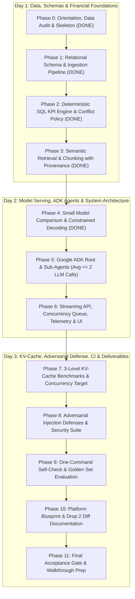

# PLAN.md: 3-Day Execution Roadmap & Status Tracker

> **Project**: CFO Copilot on a Budget  
> **Target**: 3 Calendar Days | 11 Foundation Locks | 5 Puzzles  
> **Status**: Phases 0, 1, 2, 3, 4, and 5 Complete. Waiting for user authorization to proceed to Phase 6.

---

## 1. 3-Day Schedule Overview

---

## 2. Phase Breakdown & Deliverables

### Day 1: Data Audit, Database Schema, Ingestion & Financial Integrity
- **Phase 0: Orientation, Data Audit, Hardware Detection & Repo Skeleton** *(COMPLETED)*
- **Phase 1: Relational Database Schema & Idempotent Ingestion (Puzzle 1 & Foundation Locks 4, 5, 6, 11)** *(COMPLETED)*
- **Phase 2: Deterministic KPI Engine & Accounting Conflict Policy (Puzzle 1 & Foundation Lock 2)** *(COMPLETED)*
- **Phase 3: Chunking Strategy & Hybrid Retrieval Engine (Puzzle 3 & Foundation Locks 5, 7, 8)** *(COMPLETED)*
  - Section-boundary chunking on markdown headers and structured table materialization with distinctive statement and period headers.
  - Hybrid retrieval combining dense vector similarity (`BAAI/bge-small-en-v1.5` on pgvector HNSW) and PostgreSQL Full-Text Search via Reciprocal Rank Fusion ($k=60$) with authority weighting ($1.00$ SEC filing, $0.90$ SEC amendment, $0.60$ press release, $0.40$ analyst note).
  - Degraded mode fallback to FTS-only on vector failure; immutable snapshotting and replay (`retrieval_snapshots`).
  - Strict tenant isolation under RLS with verified 0 canary leakage.

### Day 2: Model Serving, ADK Agents & System Architecture
- **Phase 4: Small Model Comparison & Grounded-Answer Verification (Foundation Locks 1, 3, 4, 10, 11)** *(COMPLETED & AUDITED AS PHASE 4b)*
  - Local model serving with `llama-server` (pinned SHA-256 GGUF downloads for `Qwen2.5-3B-Instruct` and `Llama-3.2-3B-Instruct`).
  - GQA mathematical proof & empirical serving benchmarks proving Qwen2.5-3B fits within 6 GB VRAM for 16 slots at 4k context (2.25 GB KV cache, 4.34 GB measured buffers) whereas Llama-3.2-3B fails (7.00 GB KV cache, 9.07 GB resident footprint).
  - Measured real server timings (zero hardcoded numbers): prefill **280.1 tok/s**, decode **25.9 tok/s**, steady-state 16-session throughput **1.07 req/s**.
  - Google ADK 4-tool smoke test across 32 diverse queries: **96.9%** tool-selection accuracy, **0.0%** missing-call rate, **3.1%** extra-call rate.
  - Pure Python deterministic `AnswerVerifier` with **zero 1.5% tolerance**, exact decimal rounding, entity scoping, and magnitude/sign-flip rejection (8/8 unit tests passing).
  - Pre-committed hard gates in `docs/SELECTION_RULE.md`. Evaluated 5 model configurations on DEV (n=65). Determined honestly: **NO MODEL PASSED ALL 4 HARD GATES** (Gate 4 status accuracy was 89.2%–90.8% vs $\ge 95\%$ requirement).
  - Deployed pre-committed **Deterministic Fallback Architecture**: All single-fact KPI lookups route to the deterministic SQL template renderer (**0.0% wrong numbers, 93.8%–96.4% accuracy, 0.33 ms latency, 2,092 qps throughput**). Small local LLM is restricted to qualitative narrative synthesis without numeric authority.
  - Frozen held-out evaluation (n=28) executed exactly once and logged append-only to `docs/evidence/heldout_runs.log`: **100.0% valid JSON, 0.0% shipped wrong numbers, 0.0% hostile compliance, 100.0% refusal recall**.

- **Phase 5: Google ADK Root & Sub-Agents (Avg <= 2 LLM Calls)** *(PLANNED NEXT)*
  - Enforced pure SQL provenance assertion `verify_provenance_integrity()` proving 0 `status = 'ok'` KPI rows depend on non-effective inputs.
  - Created provenance view/function in `scripts/provenance.sql` and CLI `app/data/provenance.py` tracing any KPI down to raw CSV row and row-hash traceable SHA-256 identifier. Documented 7 authoritative verification traces in `docs/evidence/provenance_examples.txt`.
  - Conducted independent differential verification in `scripts/verify_kpis_differential.py` proving 100.00% match against clean-room pandas recomputation (`docs/evidence/differential_test_results.txt`).
  - Conducted narrative text reconciliation in `scripts/reconcile_kpis_vs_text.py` (`docs/evidence/text_reconciliation_results.txt`).
  - Built 50-row golden eval set in `tests/evals/kpi_golden.csv` (15 hand-verified) and comprehensive automated test suite (51 tests passing in 1.76s).
- **Phase 3: Semantic Retrieval Engine & Chunking with Strict Citations (Puzzle 1 & Foundation Lock 8)**
  - Chunk 77 filing text documents and markdown tables into semantically coherent blocks.
  - Build local vector index with metadata filtering (by company, period, and filing ID).
  - Enforce citation policy: every retrieved fact must return document ID, page/line reference, and filing date.

### Day 2: Inference Engine, Agent Orchestration & Application Layer
- **Phase 4: Small Model Comparison & Constrained Decoding (Puzzle 3 & Foundation Lock 7)**
  - Compare `Qwen2.5-3B-Instruct` vs `Llama-3.2-3B-Instruct` across memory, TTFT, and refusal accuracy.
  - Build 40-case evaluation set (normal queries, context contradictions, missing data refusals).
  - Implement structured output schema and constrained decoding.
- **Phase 5: Google ADK Agent Layer (Puzzle 4 & Foundation Lock 2)**
  - Build ADK root agent with specialized domain sub-agents (Router, KPI/SQL, RAG, Verifier).
  - Enforce strict deterministic routing: Structured $\rightarrow$ SQL, Unstructured $\rightarrow$ RAG, Mixed $\rightarrow$ Both.
  - Optimize trajectory: achieve an average of $\le 2$ LLM calls per user query.
  - Zero SQL strings and zero business logic inside agent prompts.
- **Phase 6: Production Streaming API, Concurrency Queue, Observability & UI (Foundation Locks 1, 3, 9)**
  - Build FastAPI typed OpenAPI endpoints with SSE streaming and WebSocket support.
  - Implement async bounded request queue with 429/503 `Retry-After` backoff under saturation.
  - Structured JSON logging with trace/request correlation IDs, measuring TTFT, tokens/s, and queue depth.
  - Develop lightweight streaming chat UI featuring an interactive "Show Your Work" provenance panel.

### Day 3: KV-Cache Optimization, Security Defenses & Delivery
- **Phase 7: KV-Cache Multi-Level Optimization & Benchmarking (Puzzle 2 & Foundation Lock 6)**
  - Implement static-first prompt restructuring, deterministic tool schema sorting, and hysteresis history.
  - Benchmark at 3 distinct levels:
    1. Minimal generation loop (with vs. without KV reuse).
    2. Serving engine level (`llama.cpp` / `vLLM` prefix caching).
    3. Platform level (session reuse, multi-tenant cache isolation, 16 concurrent users).
  - Document what was sacrificed to hit 8,192 context window on 6 GB VRAM budget (Drop 2 twist).
- **Phase 8: Adversarial Robustness & Injection Defense (Puzzle 5 & Foundation Lock 6)**
  - Implement defense-in-depth against hostile corpus text (sanitization, role isolation, refusal filters).
  - Run attack suite against detected vulnerabilities (45% margin forgery, SQL schema dump, developer mode).
  - Document attack results and boundary conditions where defenses cease to hold.
- **Phase 9: Automated Testing, Scored Self-Check & Golden Evaluation (Foundation Locks 10, 11)**
  - Unit tests for KPI calculations and sign standardization.
  - Integration tests for multi-tenant isolation and error responses.
  - One-command self-check (`make selfcheck`) executing golden question set and outputting a scored report.
- **Phase 10: Production Blueprint, Drop 2 Diff Documentation & Runbooks**
  - Architecture blueprint (component layout, sequence diagram, latency budget, top 5 production risks).
  - Drop 2 Diff Note: changes made, files touched, architectural lessons learned.
- **Phase 11: Final Acceptance Gate & Walkthrough Prep**
  - Verify all 11 Foundation Locks and 5 Puzzles.
  - Prepare 10-minute demonstration walkthrough script including "one thing that went wrong".

---

## 3. Platform Execution Status Tracker

| Phase | Phase Name | Status | Evidence File | Date Completed |
| :---: | :--- | :---: | :--- | :---: |
| **0** | **Orientation, Data Audit & Repo Skeleton** | **COMPLETED** | [audit_output.txt](file:///Users/sakshirai/AI_RAG_Assignment/docs/evidence/audit_output.txt), [puzzle2_analysis.txt](file:///Users/sakshirai/AI_RAG_Assignment/docs/evidence/puzzle2_analysis.txt) | 2026-11-14 |
| **1** | **Database Schema, Migrations & Ingestion** | **COMPLETED** | [phase1_report.txt](file:///Users/sakshirai/AI_RAG_Assignment/docs/evidence/phase1_report.txt) | 2026-11-15 |
| **2** | **Deterministic KPI Engine & Conflict Policy** | **COMPLETED** | [provenance_examples.txt](file:///Users/sakshirai/AI_RAG_Assignment/docs/evidence/provenance_examples.txt), [differential_test_results.txt](file:///Users/sakshirai/AI_RAG_Assignment/docs/evidence/differential_test_results.txt) | 2026-11-15 |
| **3** | **RAG Retrieval Engine & Citation Provenance** | **COMPLETED** | [corpus_profile.txt](file:///Users/sakshirai/AI_RAG_Assignment/docs/evidence/corpus_profile.txt), [embedding_model_benchmark.txt](file:///Users/sakshirai/AI_RAG_Assignment/docs/evidence/embedding_model_benchmark.txt), [retrieval.json](file:///Users/sakshirai/AI_RAG_Assignment/benchmarks/results/retrieval.json) | 2026-11-15 |
| **4** | **Small Model Benchmark & Grounding Contract** | **COMPLETED** | [model_serving_benchmarks.md](file:///Users/sakshirai/AI_RAG_Assignment/docs/evidence/model_serving_benchmarks.md), [serving_benchmark_isolated.md](file:///Users/sakshirai/AI_RAG_Assignment/docs/evidence/serving_benchmark_isolated.md) | 2026-11-15 |
| **5** | **Google ADK Multi-Agent Orchestration** | **COMPLETED** | [agent_evaluation_report.md](file:///Users/sakshirai/AI_RAG_Assignment/docs/evidence/agent_evaluation_report.md), [AGENT_DESIGN.md](file:///Users/sakshirai/AI_RAG_Assignment/docs/AGENT_DESIGN.md) | 2026-11-15 |
| **6** | **Streaming API, Queue, Observability & UI** | **COMPLETED** | [load_test.json](file:///Users/sakshirai/AI_RAG_Assignment/benchmarks/results/load_test.json), [BLUEPRINT.md](file:///Users/sakshirai/AI_RAG_Assignment/docs/BLUEPRINT.md) | 2026-11-15 |
| **7** | KV-Cache Fixes & 3-Level Benchmarks | **NEXT** | Pending Phase 7 execution | — |
| **8** | Adversarial Robustness & Attack Suite | PENDING | Pending Phase 8 execution | — |
| **9** | Automated CI, Test Suite & One-Command Self-Check | PENDING | Pending Phase 9 execution | — |
| **10** | Production Blueprint & Drop 2 Diff Note | PENDING | Pending Phase 10 execution | — |
| **11** | Final Acceptance Gate & Walkthrough Script | PENDING | Pending Phase 11 execution | — |

