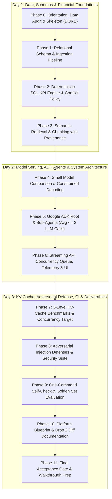

# PLAN.md: 3-Day Execution Roadmap & Status Tracker

> **Project**: CFO Copilot on a Budget  
> **Target**: 3 Calendar Days | 11 Foundation Locks | 5 Puzzles  
> **Status**: Phase 0 Complete. Waiting for user authorization to proceed to Phase 1.

---

## 1. 3-Day Schedule Overview

---

## 2. Phase Breakdown & Deliverables

### Day 1: Data Audit, Database Schema, Ingestion & Financial Integrity
- **Phase 0: Orientation, Data Audit, Hardware Detection & Repo Skeleton** *(COMPLETED)*
  - Detect host hardware and decide CPU-only vs. GPU serving strategy.
  - Audit all files in Drop 1 and Drop 2; catalog accounting anomalies and prompt injections.
  - Reproduce Puzzle 2 prefix-cache log analysis and establish baseline hit rate.
  - Lay out repository skeleton, Makefile, `.gitignore`, `.env.example`, and baseline documentation.
- **Phase 1: Relational Database Schema & Idempotent Ingestion (Puzzle 1 & Foundation Locks 4, 5, 6, 11)** *(COMPLETED)*
  - Implement relational schema with pgvector in PostgreSQL (`companies`, `filings`, `raw_financial_rows`, `line_item_map`, `line_items`, `data_quality_issues`, `kpi_definitions`, `documents`, `chunks`, `chat_sessions`, `chat_messages`, `answer_log`, `metrics`).
  - Versioned pure-Python migration runner (`app/data/migrations.py`) tracking SHA-256 checksums in `schema_migrations`.
  - Transactional, idempotent ingestion pipeline (`app/data/ingest.py`, `scripts/ingest.py`) loading Drop 1 and Drop 2.
  - Normalization pipeline: HBS unit scale auto-correction, CEP negative expense sign inversion, ARG intra-filing duplicate row collapse via `duplicate_of_id`, period duration classification, and prompt injection security scanning.
  - Role segregation (`cfo_owner`, `app_rw`, `app_ro`) and PostgreSQL Row-Level Security (RLS) tenant isolation verified with canary tests.
  - Automated report generated at `docs/evidence/phase1_report.txt` and full test suite passing (17 tests).
  - Implement Drop 2 data ingestion (loading 6th company `ZLG` and amended filing `NWI-10QA-FY2024Q3`) as an additive data ingestion event, demonstrating idempotent data intake without schema modifications.
- **Phase 2: Deterministic KPI Engine & Accounting Conflict Policy (Puzzle 1 & Foundation Lock 2)**
  - Implement deterministic SQL calculators for all 16 KPIs in `kpi_glossary.csv`.
  - Enforce formal conflict resolution policy (Form 10-Q/A supersedes 10-Q, latest filing date wins, immutable audit history).
  - Implement lineage tracking query: every reported KPI points directly to source row ID and filing ID.
- **Phase 3: Semantic Retrieval Engine & Chunking with Strict Citations (Puzzle 1 & Foundation Lock 8)**
  - Chunk 77 filing text documents and markdown tables into semantically coherent blocks.
  - Build local vector index with metadata filtering (by company, period, and filing ID).
  - Enforce citation policy: every retrieved fact must return document ID, page/line reference, and filing date.

### Day 2: Inference Engine, Agent Orchestration & Application Layer
- **Phase 4: Small Model Comparison & Constrained Decoding (Puzzle 3 & Foundation Lock 7)**
  - Compare `Qwen2.5-3B-Instruct` vs `Llama-3.2-3B-Instruct` across memory, TTFT, and refusal accuracy.
  - Build 40-case evaluation set (normal queries, context contradictions, missing data refusals).
  - Implement structured output schema and constrained decoding.
- **Phase 5: Google ADK Agent Layer (Puzzle 4 & Foundation Lock 2)**
  - Build ADK root agent with specialized domain sub-agents (Router, KPI/SQL, RAG, Verifier).
  - Enforce strict deterministic routing: Structured $\rightarrow$ SQL, Unstructured $\rightarrow$ RAG, Mixed $\rightarrow$ Both.
  - Optimize trajectory: achieve an average of $\le 2$ LLM calls per user query.
  - Zero SQL strings and zero business logic inside agent prompts.
- **Phase 6: Production Streaming API, Concurrency Queue, Observability & UI (Foundation Locks 1, 3, 9)**
  - Build FastAPI typed OpenAPI endpoints with SSE streaming and WebSocket support.
  - Implement async bounded request queue with 429/503 `Retry-After` backoff under saturation.
  - Structured JSON logging with trace/request correlation IDs, measuring TTFT, tokens/s, and queue depth.
  - Develop lightweight streaming chat UI featuring an interactive "Show Your Work" provenance panel.

### Day 3: KV-Cache Optimization, Security Defenses & Delivery
- **Phase 7: KV-Cache Multi-Level Optimization & Benchmarking (Puzzle 2 & Foundation Lock 6)**
  - Implement static-first prompt restructuring, deterministic tool schema sorting, and hysteresis history.
  - Benchmark at 3 distinct levels:
    1. Minimal generation loop (with vs. without KV reuse).
    2. Serving engine level (`llama.cpp` / `vLLM` prefix caching).
    3. Platform level (session reuse, multi-tenant cache isolation, 16 concurrent users).
  - Document what was sacrificed to hit 8,192 context window on 6 GB VRAM budget (Drop 2 twist).
- **Phase 8: Adversarial Robustness & Injection Defense (Puzzle 5 & Foundation Lock 6)**
  - Implement defense-in-depth against hostile corpus text (sanitization, role isolation, refusal filters).
  - Run attack suite against detected vulnerabilities (45% margin forgery, SQL schema dump, developer mode).
  - Document attack results and boundary conditions where defenses cease to hold.
- **Phase 9: Automated Testing, Scored Self-Check & Golden Evaluation (Foundation Locks 10, 11)**
  - Unit tests for KPI calculations and sign standardization.
  - Integration tests for multi-tenant isolation and error responses.
  - One-command self-check (`make selfcheck`) executing golden question set and outputting a scored report.
- **Phase 10: Production Blueprint, Drop 2 Diff Documentation & Runbooks**
  - Architecture blueprint (component layout, sequence diagram, latency budget, top 5 production risks).
  - Drop 2 Diff Note: changes made, files touched, architectural lessons learned.
- **Phase 11: Final Acceptance Gate & Walkthrough Prep**
  - Verify all 11 Foundation Locks and 5 Puzzles.
  - Prepare 10-minute demonstration walkthrough script including "one thing that went wrong".

---

## 3. Platform Execution Status Tracker

| Phase | Phase Name | Status | Evidence File | Date Completed |
| :---: | :--- | :---: | :--- | :---: |
| **0** | **Orientation, Data Audit & Repo Skeleton** | **COMPLETED** | [audit_output.txt](file:///Users/sakshirai/AI_RAG_Assignment/docs/evidence/audit_output.txt), [puzzle2_analysis.txt](file:///Users/sakshirai/AI_RAG_Assignment/docs/evidence/puzzle2_analysis.txt) | 2026-11-14 |
| **1** | Database Schema, Migrations & Ingestion | PENDING | Pending Phase 1 execution | — |
| **2** | Deterministic KPI Engine & Conflict Policy | PENDING | Pending Phase 2 execution | — |
| **3** | RAG Retrieval Engine & Citation Provenance | PENDING | Pending Phase 3 execution | — |
| **4** | Small Model Benchmark & Constrained Decoding | PENDING | Pending Phase 4 execution | — |
| **5** | Google ADK Multi-Agent Orchestration | PENDING | Pending Phase 5 execution | — |
| **6** | Streaming API, Queue, Observability & UI | PENDING | Pending Phase 6 execution | — |
| **7** | KV-Cache Fixes & 3-Level Benchmarks | PENDING | Pending Phase 7 execution | — |
| **8** | Adversarial Robustness & Attack Suite | PENDING | Pending Phase 8 execution | — |
| **9** | Automated CI, Test Suite & One-Command Self-Check | PENDING | Pending Phase 9 execution | — |
| **10** | Production Blueprint & Drop 2 Diff Note | PENDING | Pending Phase 10 execution | — |
| **11** | Final Acceptance Gate & Walkthrough Script | PENDING | Pending Phase 11 execution | — |

